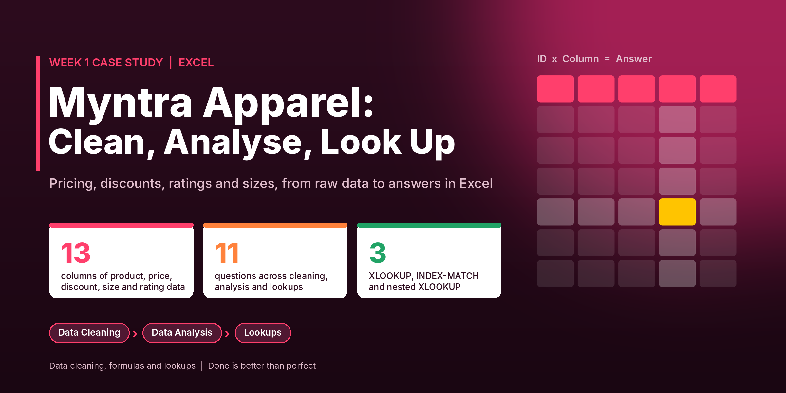

<h1 align="center">Myntra Apparel — Data Cleaning, Analysis & Lookup in Excel</h1>

<p align="center">
  
  
  
  
</p>

<p align="center">
  
</p>

## Overview

A Week 1 Excel case study on a dataset of Myntra apparel listings, built to give management insight into pricing, discounts, ratings and available sizes. The work moves from raw data to answers in three parts:

- **Data cleaning and preparation** — remove duplicates, standardise discount offers, fill missing discount prices and handle missing sizes
- **Data analysis** — average price for highly rated products, discount counts, size availability and a High/Low Discount label
- **Data retrieval and lookup** — find product details by Product ID with VLOOKUP/XLOOKUP, INDEX-MATCH and a nested XLOOKUP

## The Dataset

One row per product, 13 columns:

| Column | Description |
|---|---|
| `URL` | Product page link |
| `Product_id` | Unique product identifier, used as the lookup key |
| `BrandName` | Brand of the product |
| `Category` | Broad category (for example Topwear, Bottom Wear, Western, Indian Wear) |
| `Individual_category` | Specific type (for example jeans, tshirts, kurtas) |
| `category_by_Gender` | Men or Women |
| `Description` | Product title text |
| `DiscountPrice (in Rs)` | Price after discount |
| `OriginalPrice (in Rs)` | List price before discount |
| `DiscountOffer` | Offer text such as "55% OFF" |
| `SizeOption` | Comma-separated sizes available |
| `Ratings` | Average customer rating |
| `Reviews` | Number of reviews |

## Tech Stack

```
Microsoft Excel
├── Remove Duplicates         → Duplicate check and removal
├── Text functions            → TRIM, LEFT, FIND, VALUE to standardise offers
├── Logical functions         → IF, AND for filling and labelling
├── Conditional aggregates    → AVERAGEIFS, COUNTIF, SUMPRODUCT
└── Lookup functions          → VLOOKUP, XLOOKUP, INDEX-MATCH, nested XLOOKUP
```

## Questions & Approach

Column letters below assume the 13 columns above start in column A (`Product_id` in B, `Category` in D, `DiscountPrice` in H, `OriginalPrice` in I, `DiscountOffer` in J, `SizeOption` in K, `Ratings` in L).

**A. Data cleaning and preparation**

| # | Task | Approach |
|---|---|---|
| A1 | Remove duplicate rows | Data → Remove Duplicates across all columns, then check the row count before and after |
| A2 | Standardise `DiscountOffer` | Strip extra spaces and trailing text so every value follows one format, for example `=IF(J2="","",VALUE(LEFT(TRIM(J2),FIND("%",TRIM(J2))-1))&"% OFF")` |
| A3 | Fill `DiscountPrice` where both it and `DiscountOffer` are blank | `=IF(AND(H2="",J2=""),AVERAGEIFS(H:H,D:D,D2),H2)`, calculated first and pasted as values so the averages use only the original data |
| A4 | Replace blank `SizeOption` with "Not Available" | Go To Special → Blanks, type "Not Available" and press Ctrl+Enter (or `=IF(K2="","Not Available",K2)`) |

**B. Data analysis**

A helper column holds the numeric discount (`=VALUE(LEFT(J2,FIND("%",J2)-1))`) so offers can be compared as numbers.

| # | Task | Approach |
|---|---|---|
| B1 | Average original price where rating is above 4 | `=AVERAGEIFS(I:I,L:L,">4")` |
| B2 | Count products with discount above 50% OFF | `=COUNTIF(helper_column,">50")` (strictly greater, so exactly 50% is excluded) |
| B3 | Count products available in size M | `=SUMPRODUCT(--ISNUMBER(SEARCH(", M,",", "&K2:K{last_row}&",")))` which matches M as a whole size, not as part of another size |
| B4 | Label as High or Low Discount | `=IF(helper_column>50,"High Discount","Low Discount")` |

**C. Data retrieval and lookup**

| # | Task | Approach |
|---|---|---|
| C1 | Brand, price and rating for Product_id 11226634 | `=XLOOKUP(11226634,B:B,C:C)` for brand, and the same with `H:H` / `I:I` for price and `L:L` for rating; or `=VLOOKUP(11226634,B:M,2,FALSE)` with column index 2 for brand, 7 or 8 for price, 11 for rating |
| C2 | `DiscountPrice` for Product ID 6744434 | `=INDEX(H:H,MATCH(6744434,B:B,0))` |
| C3 | Any column for any product ID | `=XLOOKUP(product_id,$B$2:$B$N,XLOOKUP(column_name,$A$1:$M$1,$A$2:$M$N))`, where the inner lookup returns the chosen column and the outer lookup picks the matching row |

## Data Quality Observations

Seen in the first rows of the dataset, so confirm them on the full file:

- **Many `DiscountPrice` values are blank**, including rows where an offer is present and rows where both price and offer are blank (the group the cleaning step fills).
- **`DiscountOffer` is inconsistent**, with variants like "60% OFF, Hurry*" and " 45 % OFF" (stray spaces) next to the standard "55% OFF", which is why standardising it comes first.
- **Many products sit at exactly 50% OFF**, so whether the rule is "greater than 50%" or "50% or more" changes the High Discount count.
- **`SizeOption` is free text**, with "Onesize" for single-size items and sizes not always in order, so it is matched as a text list rather than a number.
- **Category text has uneven spacing** (for example a double space in "Inner Wear &  Sleep Wear"), so trim it before grouping.

## How to Use

1. Clone or download this repository.
2. Open `Myntra_Apparel_Analysis.xlsx` in Microsoft Excel (365 or 2021 recommended for XLOOKUP).
3. Work through the cleaning, analysis and lookup sheets in order.
4. Enter a Product ID in the lookup sheet to pull any column for that product.

## Repository Structure

```
myntra-apparel-excel-analysis
├── Myntra_Apparel_Analysis.xlsx     ← Cleaned data, formulas and lookups (add your file here)
├── Myntra_Case_Study.pdf            ← Submission deck (add your file here)
├── cover.png                        ← Repo cover image
└── README.md
```

---

## About Me

**Anmol Agarwal**
Business Analyst

[](https://www.linkedin.com/in/anmol-agarwal123/)
[](https://github.com/Anmolagarwal19)
[](mailto:agarwalanmol799@gmail.com)

*If this project was useful, a star on the repo is appreciated — feel free to reach out for feedback, questions, or opportunities.*
